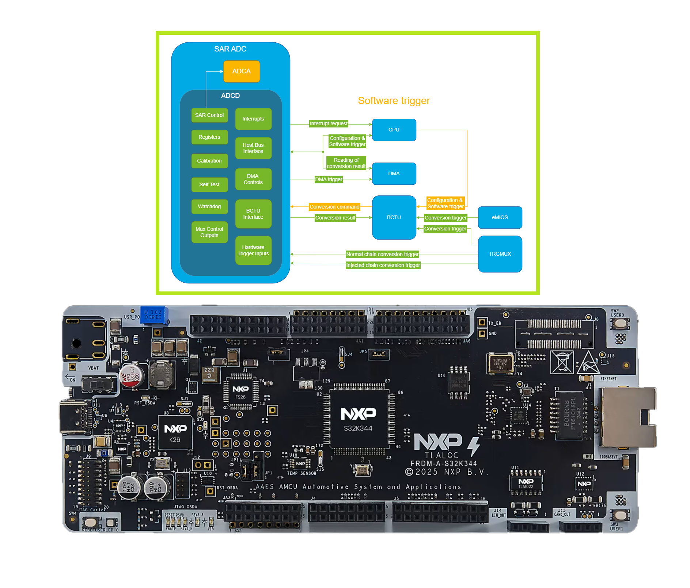
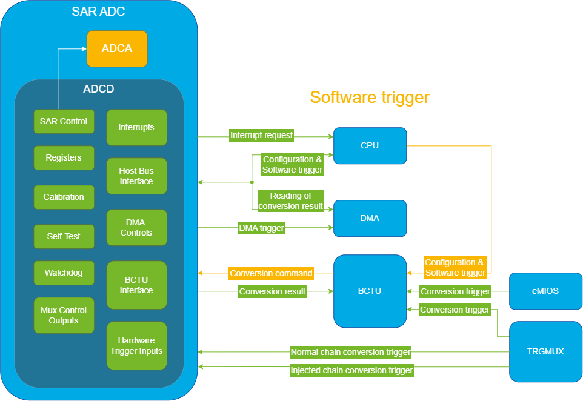
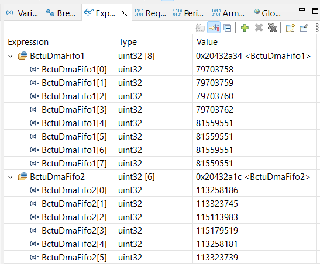

# NXP Application Code Hub

## BCTU Control of ADC Sampling
This demo illustrates the use of the SAR ADC and BCTU modules, where ADC conversions are initiated through a BCTU software trigger. The implementation relies on RTD high-level (MCAL) drivers to perform ADC channel conversions.

The BCTU operates in Control Mode, taking full control of the ADC module and managing all ADC sampling through software-triggered conversions. Instead of sampling external analog inputs, the ADC channels are configured to measure the internal bandgap reference and VREFH voltage, typically around 1.2 V and 5 V, respectively.

[

](./images/FRDM_A_S32K344_ADC_BCTU_DMA_Graph.png)

#### Boards: FRDM-A-S32K344
#### Categories: Motor Control
#### Peripherals: ADC, BCTU
#### Toolchains: S32 Design Studio IDE

## Table of Contents
1. [Software and Tools](#step1)
2. [Hardware](#step2)
3. [Setup](#step3)
4. [Results](#step4)
5. [Support](#step5)
6. [Release Notes](#step6)

## 1. Software and Tools
This example was developed using the FRDM Automotive Bundle for S32K3 + S32M27. To download and install the complete software and tools ecosystem, use the following link:
- [ FRDM Automotive S32K3 + S32M27 Board Installation Package](https://www.nxp.com/app-autopackagemgr/automotive-software-package-manager:AUTO-SW-PACKAGE-MANAGER?currentTab=0&selectedDevices=S32K3&applicationVersionID=203)

## 2. Hardware
- Type-C USB cable
- Personal Computer
- [FRDM-A-S32K344](https://www.nxp.com/design/design-center/development-boards-and-designs/FRDM-A-S32K344)

## 3. Setup
### 3.1 Import the project to S32 Design Studio IDE

1. Open S32 Design Studio IDE, in the Dashboard Panel, choose **Import project from Application Code Hub**.
[

](./images/import_project_1.png)

2. You can find the demo you need by searching for the name directly "BCTU Control of ADC Sampling". Open the project, click the **GitHub link** from this window, S32 Design Studio IDE will automatically retrieve project attributes then click **Next>**.
[

](./images/import_project_2.png)

3. Select **main** branch and then click **Next>**.

4. Select your local path for the repo in **Destination->Directory** window. The S32 Design Studio IDE will clone the repo into this path, click **Next>**.

5. Select **Import existing Eclipse projects** then click **Next>**.

6. Select the project in this repo (only one project in this repo) then click **Finish**.

### 3.2 Generating, building and running the example application
1. In Project Explorer, right-click the project and select **Update Code and Build Project**. This will generate the configuration (Pins, Clocks, Peripherals), update the source code and build the project using the active configuration (e.g. Debug_FLASH).
Make sure the build completes successfully and the *.elf file is generated without errors.
[

](./images/update_and_build.png)
Press **Yes** in the **SDK Component Management** pop-up window to continue.

2. Go to **Debug** and select **Debug Configurations**. There will be a debug configuration for this project:
[

](./images/Debug_config.png)

        Configuration Name                  Description
        -------------------------------     -----------------------
        $(example)_debug_flash_pemicro      Debug the FLASH configuration using PEmicro probe

    Select the desired debug configuration and click on **Debug**. Now the perspective will change to the **Debug Perspective**.
    Use the controls to control the program flow.

## 4. Results

The demo is divided into 3 parts:

   Part 1: BCTU control mode, using list mode for conversion on all ADC instances in series, data conversion is updated by DMA.

   Part 2: BCTU control mode for parallel conversions from all ADC instances using list mode, data conversion is updated by DMA.

   Part 3: Verify that the data transmitted to the larger buffers through DMA is correct.
       [

](./images/ADC_BCTU_SWTrigger.png)

When you suspend the debugging session, in *Expressions tab* you can observe the results: **BctuDmaFifo1** and **BctuDmaFifo2**, which are used to store raw data from BCTU FIFOs according to the trigger and BCTU List, then all of them are transferred to ***DmaCh1_DestinationBuffer*** and ***DmaCh17_DestinationBuffer*** which will store all the corresponding measurements for each BCTU FIFO, after that a check is performed to see if the results transferred to both buffers are correct.

Verification criteria for a successful example run is **bStatus** being TRUE at the end of the example.
An example check file was included that is used to automatically test examples, this writes a pass or fail status in the memory at a certain address.
    [

](./images/FIFOs_Results.png)

## 5. Support
For general technical questions related to NXP microcontrollers, please use the [NXP Community Forum](https://community.nxp.com/).

#### Project Metadata

<!----- Boards ----->

<!----- Categories ----->

<!----- Peripherals ----->

<!----- Toolchains ----->

Questions regarding the content/correctness of this example can be entered as Issues within this GitHub repository.

>**Note**: For more general technical questions regarding NXP Microcontrollers and the difference in expected functionality, enter your questions on the [NXP Community Forum](https://community.nxp.com/)

## 6. Release Notes
| Version | Description / Update                           | Date                           |
|:-------:|------------------------------------------------|-------------------------------:|
| 1.0     | Initial release on Application Code Hub        | September 30th 2026 |